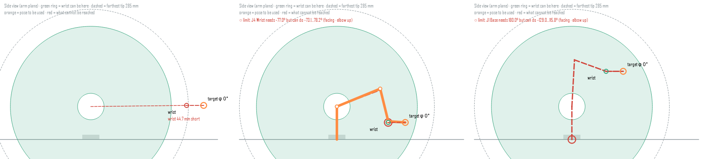
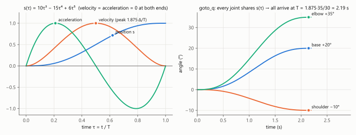
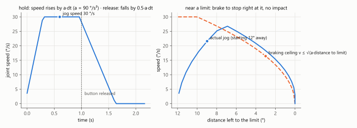
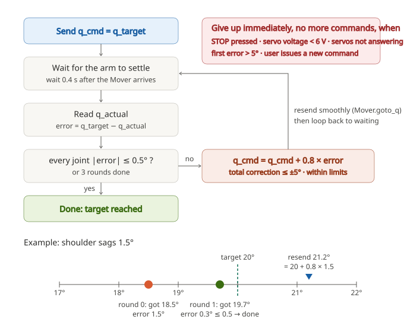

# How the maths works — RobotArmV2 (4-joint arm: base, shoulder, elbow, wrist; PC drives the servos directly)

Charts are generated from the real code by `docs/make_charts.py` (edit a formula and re-run) · the FK/IK arm figures are adapted from RobotControl `v2/docs` to the 4-row DH table

## 1. Overview: data flow from the window to the servos


| File | Job |
|---|---|
| `qt_app.py` | the window (Joint · Jog · IK · Status · 3D) |
| `motion.py` | **pose streamer** — computes the next pose step by step (sections 4–5) |
| `driver.py` | thread that sends poses to the arm + safety + correction (sections 6–7) |
| `link.py` / `scs.py` | q ↔ raw conversion, then SCS packets over COM11 |
| `kinematics.py` / `singularity.py` | FK, IK (sections 2–3) · singularity check (section 8) |
| `ik_explain.py` / `ik_sketch.py` | why IK cannot reach a target + the drawing in the IK tab (section 3.1) |

## 2. Forward Kinematics: joint angles → tip position


- 4-row DH table (head servo J5 removed → wrist to tip is one straight link, **a4 = 50 mm**):

| Link | a (mm) | α | d (mm) | θ |
|---|---|---|---|---|
| 1 base | 0 | 90° | 96.7 | θ₁ |
| 2 shoulder | 137.0 | 0 | 0 | θ₂ |
| 3 elbow | 98.3 | 0 | 0 | θ₃ |
| 4 wrist | 50.0 | 0 | 0 | θ₄ |
- The servo angle q (0 = straight up) is not the DH angle θ → convert before the equations (only in `q_to_theta`):

| Joint | θ (DH) | Why |
|---|---|---|
| J1 base | θ₁ = q₁ | base positive = counter-clockwise = positive θ about z₀ |
| J2 shoulder | θ₂ = 90° − q₂ | θ₂ is measured from horizontal · upright = 90° |
| J3 elbow | θ₃ = −q₃ | elbow leaning forward (positive q) = clockwise in the arm plane |
| J4 wrist | θ₄ = −q₄ | wrist leaning forward = clockwise, like the elbow |

- `T⁰₄ = A₁A₂A₃A₄` → 4th column = position (x, y, z) · **φ = θ2 + θ3 + θ4** (tip angle vs horizontal — the shoulder, elbow and wrist axes are parallel, so the angles simply add)
- The 4-row table gives exactly the same tip as the old 5-row table (α₄ = 90°, d5 = 50, θ₅ = 0) in every pose — a test checks 300 poses

### 2.1 Homogeneous Transformation table (link by link)

The matrix of each link (FK slides), multiplied in turn: **T⁰ᵢ = T⁰ᵢ₋₁ · Aᵢ** (code: `dh_matrix`, `forward_kinematics`)

```
       ┌ cθᵢ  −sθᵢ·cαᵢ   sθᵢ·sαᵢ   aᵢ·cθᵢ ┐
Aᵢ  =  │ sθᵢ   cθᵢ·cαᵢ  −cθᵢ·sαᵢ   aᵢ·sθᵢ │   = Rot(z,θᵢ) · Trans(z,dᵢ) · Trans(x,aᵢ) · Rot(x,αᵢ)
       │ 0     sαᵢ       cαᵢ       dᵢ     │
       └ 0     0         0         1      ┘
```

| Link | θᵢ | dᵢ (mm) | aᵢ (mm) | αᵢ | What Aᵢ does |
|---|---|---|---|---|---|
| 1 base | θ₁ = q₁ | 96.7 | 0 | 90° | turn about the vertical axis → rise 96.7 → tip z over to horizontal (the shoulder axis) |
| 2 shoulder | θ₂ = 90° − q₂ | 0 | 137.0 | 0 | rotate in the arm plane → reach out 137.0 |
| 3 elbow | θ₃ = −q₃ | 0 | 98.3 | 0 | rotate in the arm plane → reach out 98.3 |
| 4 wrist | θ₄ = −q₄ | 0 | 50.0 | 0 | rotate in the arm plane → reach out 50.0 to the tip |

Substitute and multiply (links 2–4 rotate in the same plane, so their angles add):

```
      ┌ c1  0   s1   0  ┐         ┌ c2  −s2  0  a2·c2 ┐         ┌ c3  −s3  0  a3·c3 ┐         ┌ c4  −s4  0  a4·c4 ┐
A1 =  │ s1  0  −c1   0  │   A2 =  │ s2   c2  0  a2·s2 │   A3 =  │ s3   c3  0  a3·s3 │   A4 =  │ s4   c4  0  a4·s4 │
      │ 0   1   0    d1 │         │ 0    0   1  0     │         │ 0    0   1  0     │         │ 0    0   1  0     │
      └ 0   0   0    1  ┘         └ 0    0   0  1     ┘         └ 0    0   0  1     ┘         └ 0    0   0  1     ┘

         ┌ c1·c234  −c1·s234   s1   c1·R  ┐      R = a2·c2 + a3·c23 + a4·c234   (horizontal distance from the base axis)
T⁰₄  =   │ s1·c234  −s1·s234  −c1   s1·R  │      Z = a2·s2 + a3·s23 + a4·s234   (height above the shoulder axis)
         │ s234      c234      0    d1+Z  │      ci = cos θi,  c23 = cos(θ2+θ3),  c234 = cos(θ2+θ3+θ4) = cos φ
         └ 0         0         0    1     ┘
```

**Numeric example** q = (30°, 40°, 40°, 50°) → θ = (30°, 50°, −40°, −50°) (computed by the real code):

```
A1 (θ1 = 30°)                     A2 (θ2 = 50°)                     A3 (θ3 = −40°)                    A4 (θ4 = −50°)
┌ 0.866  0      0.500   0    ┐    ┌ 0.643 −0.766  0   88.1 ┐      ┌  0.766  0.643  0   75.3 ┐      ┌  0.643  0.766  0   32.1 ┐
│ 0.500  0     −0.866   0    │    │ 0.766  0.643  0  104.9 │      │ −0.643  0.766  0  −63.2 │      │ −0.766  0.643  0  −38.3 │
│ 0      1      0      96.7  │    │ 0      0      1    0   │      │  0      0      1    0   │      │  0      0      1    0   │
└ 0      0      0       1    ┘    └ 0      0      0    1   ┘      └  0      0      0    1   ┘      └  0      0      0    1   ┘

T⁰₂ = A1·A2                       T⁰₃ = T⁰₂·A3                      T⁰₄ = T⁰₃·A4
┌ 0.557 −0.663  0.500   76.3 ┐    ┌ 0.853 −0.150  0.500  160.1 ┐    ┌  0.663  0.557  0.500  193.3 ┐
│ 0.321 −0.383 −0.866   44.0 │    │ 0.492 −0.087 −0.866   92.4 │    │  0.383  0.321 −0.866  111.6 │
│ 0.766  0.643  0      201.6 │    │ 0.174  0.985  0      218.7 │    │ −0.643  0.766  0      186.6 │
└ 0      0      0        1   ┘    └ 0      0      0        1   ┘    └  0      0      0        1   ┘
```

| Point | 4th column of | x (mm) | y (mm) | z (mm) |
|---|---|---|---|---|
| o₁ shoulder axis | T⁰₁ | 0 | 0 | 96.7 |
| o₂ elbow | T⁰₂ | 76.3 | 44.0 | 201.6 |
| o₃ wrist | T⁰₃ | 160.1 | 92.4 | 218.7 |
| **o₄ arm tip** | **T⁰₄** | **193.3** | **111.6** | **186.6** |

- Check: R = √(193.3² + 111.6²) = 223.2 mm, Z = 186.6 − 96.7 = 89.9 mm · φ = 50 − 40 − 50 = **−40°** (matches the side-view figure)
- Column 1 of T⁰₄ = the direction the tip points (x₄) · column 3 = the pitch joints' rotation axis (z₁ = z₂ = z₃, parallel) · a test checks that the T⁰₄ formula above equals the code in every pose

## 3. Inverse Kinematics: position → joint angles


1. θ1 = atan2(y, x) · 2. step back from the tip to the wrist along φ · 3. law of cosines gives θ3 · 4. θ2 · 5. θ4 = φ − θ2 − θ3
- **Near the base axis** (r < 30 mm) the slides' second solution θ1 + 180° with negative r is used when it is closer to the current base angle — otherwise a tip 0.2 mm behind the axis made atan2 jump to 180° (base out of limit)
- **φ not reachable** (position reachable, angle not) → the window finds the nearest reachable φ (1° steps) and says so in the Log

### 3.1 Why a target cannot be reached (shown in the IK tab — `ik_explain.py`, `ik_sketch.py`)



Preview / Go runs through the IK steps and draws a side view (green ring = where the wrist can be, red = what cannot be reached):

| Check | Fails when | Example message |
|---|---|---|
| tip distance from the shoulder axis | > a2 + a3 + a4 = 285.3 mm | Too far … 44.7 mm short → move the target towards the shoulder axis |
| wrist (a4 back from the target along φ) | outside \|a2 − a3\| … a2 + a3 = 38.7 … 235.3 mm from the shoulder | wrist is 254.3 mm from the shoulder … 19.0 mm short |
| joint limits | needed angle outside Q_MIN … Q_MAX | J4 Wrist needs −77.0° but can do −73.1…78.2° (3.9° over) |
| base | target behind the base (needs 180°) | the base only turns −129.0…115.8° |

- Tries **all 4 poses from the slides**: facing θ₁ = Atan2 / facing away θ₁ = π + Atan2 × elbow up/down, and says why each one fails (the program only uses the facing poses on the real arm)
- Shows the **reachable φ ranges** at that position, e.g. −106…−4°, and warns when the target is below the base (z < 0 — the limits do not protect the table yet)
- The pose the arm really takes keeps the old rule (elbow up → elbow down → nearest φ); this only adds the explanation

## 4. Smooth motion: the min-jerk profile (`Mover.goto_q`)



- **s(τ) = 10τ³ − 15τ⁴ + 6τ⁵**, τ = t / T → starts and ends with velocity = acceleration = 0 (no jerk at start/stop)
- Every joint uses the same s(τ): q(t) = q₀ + (q₁ − q₀)·s(t/T) → **all joints arrive together**
- Duration **T = 1.875 · Δ_max / v** (the peak velocity of s is 1.875 at τ = 0.5) · v = 150 °/s · going to Standby uses v = **60 °/s** (e.g. 90° takes 2.8 s)
- Straight line to X Y Z (`goto_xyz`): split the line every 1 mm, IK at every point, same s(τ) · T = 1.875 × max(length / 300 mm/s, time the fastest joint needs at 150 °/s)
- **Dragging a slider** (`follow`): the goal keeps changing, so no s(τ) — chase it with acceleration a = **600 °/s²** and ceiling **v ≤ min(150, √(2a·|error|))** → it slows down and stops exactly at the goal

## 5. Jog: hold / release / brake before a limit



- Velocity changes by at most **a·dt** per step (a = 90 °/s², jog 30 °/s, tip 40 mm/s) · on release: decelerate at **0.5·a** (full a made the arm bounce), then correct sag at the stop pose
- Near a limit: ceiling **v ≤ √(a · distance to the limit)** → arrives at the limit slowly (the old √(2a·distance) let the ramp fall behind and hit at ~14 °/s)
- Tip jog: tip += v·dt then IK, trying the current φ first then the nearest φ within ±30° (position matters more than angle) · if a joint would have to spin faster than the jog speed → shrink the step rather than stop

## 6. Sending the pose 80 ms ahead (`Mover.peek`) — fixing jerky jog


- Measured: a thread set to 40 ms on Windows actually ticks every **27–52 ms**
- Before: send "the current pose" + a fixed 60 ms → each step's distance varied with the tick → servo speed swung ±10.8 around a mean of 22.4 °/s (**±48%**)
- Now: send **the pose 80 ms ahead** + 80 ms → servo speed = (goal − now) / 80 ms ≈ v (measured mean 25.9 °/s for a set 30 — the servo lags slightly)
- Measured on the elbow jogging at 30 °/s: swing ±10.8 → **±5.8 °/s**, lag 4.4° → **2.5°**

## 7. Correcting sag after arriving (`Driver._correction`)



wait 0.4 s for the arm to settle → error = q_target − q_actual → joints with |error| > 0.5°: **offset ← offset + 0.8·error**, then send **q_target + offset** (smoothly), ≤ 3 rounds, total offset ≤ ±5° · a first error > 5° = never got there, no correction

- The offset **accumulates** each round (= integral control, one round at a time) → constant sag from gravity still reaches the goal · sending a fresh q_target + 0.8·error each round would never reach the goal (some error always remains)

## 8. Singularity: poses where the tip loses a direction (`singularity.py`)


- **|det J| = r · a2 · a3 · |sin θ3|** → 0 when the tip is on the base axis (r = 0) or the arm is fully stretched/folded (θ3 = 0°/180°)
- Evidence: compute J numerically (nudge each joint by 0.001°) and take det → **matches the formula in every pose** (left chart, tests on 300 random poses)
- In the window: the box right of Forward Kinematics shows det both ways + σ_min · red = near a singularity · tip jog stops before entering one

## 9. Servo angle q ↔ raw (`config.py`)

```
raw = center + dir × q × 4.092        (1023 ticks / 250° = 4.092 ticks/°)
q   = dir × (raw − center) / 4.092
```
center = raw when the link points straight up · dir = +1/−1 so positive q = lean forward / base turns left · recalibrate: `Calibrate.bat`
