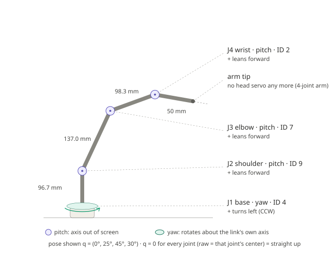
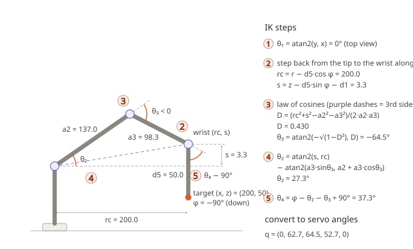
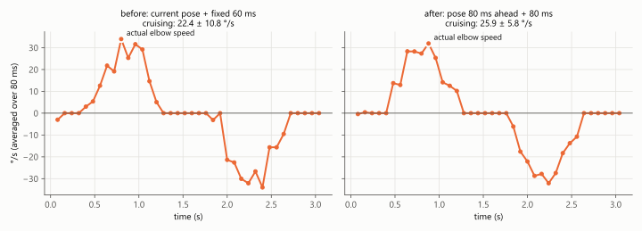
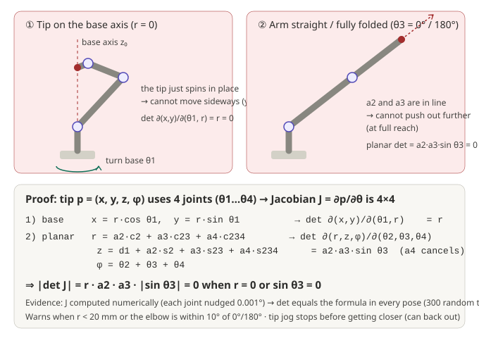

# How the maths works — RobotArmV2 (4-joint arm, PC drives the servos directly)

Charts are generated from the real code by `docs/make_charts.py` (edit a formula and re-run) · the FK/IK arm figures come from RobotControl `v2/docs` (already d5 = 50 mm)

## 1. Overview: data flow from the window to the servos


| File | Job |
|---|---|
| `qt_app.py` | the window (Joint · Jog · IK · Status · 3D) |
| `motion.py` | **pose streamer** — computes the next pose step by step (sections 4–5) |
| `driver.py` | thread that sends poses to the arm + safety + correction (sections 6–7) |
| `link.py` / `scs.py` | q ↔ raw conversion, then SCS packets over COM11 |
| `kinematics.py` / `singularity.py` | FK, IK (sections 2–3) · singularity check (section 8) |

## 2. Forward Kinematics: joint angles → tip position




- DH table: d1 = 96.7, a2 = 137.0, a3 = 98.3, **d5 = 50** mm (J5 head removed → q5 = 0)
- `T⁰₅ = A₁A₂A₃A₄A₅` → 4th column = position (x, y, z) · φ = θ2 + θ3 + θ4 − 90° (tip angle vs horizontal)

## 3. Inverse Kinematics: position → joint angles



1. θ1 = atan2(y, x) · 2. step back from the tip to the wrist along φ · 3. law of cosines gives θ3 · 4. θ2 · 5. θ4 = φ − θ2 − θ3 + 90°
- **Near the base axis** (r < 30 mm) the slides' second solution θ1 + 180° with negative r is used when it is closer to the current base angle — otherwise a tip 0.2 mm behind the axis made atan2 jump to 180° (base out of limit)
- **φ not reachable** (position reachable, angle not) → the window finds the nearest reachable φ (1° steps) and says so in the Log

## 4. Smooth motion: the min-jerk profile (`Mover.goto_q`)


- **s(τ) = 10τ³ − 15τ⁴ + 6τ⁵**, τ = t / T → starts and ends with velocity = acceleration = 0 (no jerk at start/stop)
- Every joint uses the same s(τ): q(t) = q₀ + (q₁ − q₀)·s(t/T) → **all joints arrive together**
- Duration **T = 1.875 · Δ_max / v** (the peak velocity of s is 1.875 at τ = 0.5) · v = 150 °/s
- Straight line to X Y Z (`goto_xyz`): split the line every 1 mm, IK at every point, same s(τ)

## 5. Jog: hold / release / brake before a limit


- Velocity changes by at most **a·dt** per step (a = 90 °/s², jog 30 °/s, tip 40 mm/s) · on release: decelerate at **0.5·a** (full a made the arm bounce), then correct sag at the stop pose
- Near a limit: ceiling **v ≤ √(a · distance to the limit)** → arrives at the limit slowly (the old √(2a·distance) let the ramp fall behind and hit at ~14 °/s)
- Tip jog: tip += v·dt then IK, trying the current φ first then the nearest φ within ±30° (position matters more than angle) · if a joint would have to spin faster than the jog speed → shrink the step rather than stop

## 6. Sending the pose 80 ms ahead (`Mover.peek`) — fixing jerky jog



- Measured: a thread set to 40 ms on Windows actually ticks every **27–52 ms**
- Before: send "the current pose" + a fixed 60 ms → each step's distance varied with the tick → servo speed swung ±30%
- Now: send **the pose 80 ms ahead** + 80 ms → servo speed = (goal − now) / 80 ms = v, always
- Measured on the elbow jogging at 30 °/s: swing ±10.8 → **±5.8 °/s**, lag 4.4° → **2.5°**

## 7. Correcting sag after arriving (`Driver._correction`)


error = q_target − q_actual → joints with |error| > 0.5° are sent q_target + 0.8·error (smoothly), ≤ 3 rounds, total ≤ ±5° · a first error > 5° = never got there, no correction

## 8. Singularity: poses where the tip loses a direction (`singularity.py`)




- **|det J| = r · a2 · a3 · |sin θ3|** → 0 when the tip is on the base axis (r = 0) or the arm is fully stretched/folded (θ3 = 0°/180°)
- Evidence: compute J numerically (nudge each joint by 0.001°) and take det → **matches the formula in every pose** (left chart, tests on 300 random poses)
- In the window: the box right of Forward Kinematics shows det both ways + σ_min · red = near a singularity · tip jog stops before entering one

## 9. Servo angle q ↔ raw (`config.py`)

```
raw = center + dir × q × 4.092        (1023 ticks / 250° = 4.092 ticks/°)
q   = dir × (raw − center) / 4.092
```
center = raw when the link points straight up · dir = +1/−1 so positive q = lean forward / base turns left · recalibrate: `Calibrate.bat`
